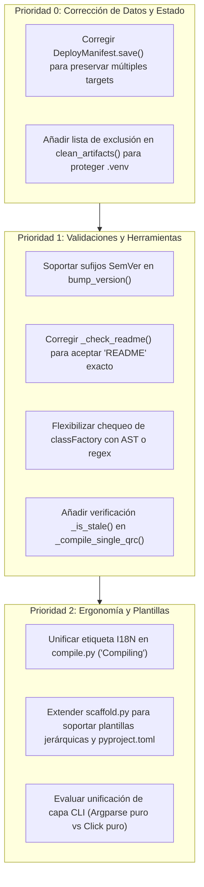

# Informe de Análisis Técnico de Código — QGIS Plugin Manager (v0.15.1)

**Fecha**: 2026-11-01
**Alcance**: Análisis manual del código fuente de producción en `src/qgis_manager/` (49 módulos Python y plantillas asociadas), evaluando arquitectura, seguridad, robustez, consistencia y calidad de implementación.
**Versión analizada**: `0.15.1` (según `pyproject.toml`).
**Método**: Inspección estática y manual exhaustiva del código fuente sin intermediación de documentación auxiliar.

---

## 1. Resumen Ejecutivo y Diagnóstico Global

El paquete `qgis-manage` (`src/qgis_manager/`) presenta un diseño modular maduro, con una clara separación entre la orquestación CLI, la capa de servicios (`core/`), las reglas de validación (`validation/`) y las utilidades del dominio (metadatos, empaquetado, nomenclatura y control de exclusiones).

La herramienta destaca por su apego al principio de dependencias mínimas en tiempo de ejecución (únicamente `click>=8.0`), delegando el grueso de las operaciones en la biblioteca estándar de Python (`tomllib`, `argparse`, `dataclasses`, `zipfile`, `hashlib`, `subprocess`, `fnmatch`).

| Métrica / Dimensión | Estado | Observación |
| :--- | :---: | :--- |
| **Separación CLI / Core** | Excelente | Lógica de negocio centralizada en `core/` y `validation/`. |
| **Seguridad de Rutas** | Alta | Sanitización estricta de *slugs* y comprobación de límites de directorios. |
| **Reproducibilidad de Build** | Excelente | Soporte de `SOURCE_DATE_EPOCH`, normalización de permisos y timestamps deterministas. |
| **Persistencia de Configuración** | Alta | Edición quirúrgica por líneas en `metadata.txt` y `pyproject.toml` sin pérdida de formato. |
| **Fiabilidad Operativa** | Regular a Buena | Se identificaron 3 defectos de lógica (manifest multiobjetivo, falso positivo en README y bumping de versiones SemVer). |

---

## 2. Fortalezas de Diseño y Puntos Destacados

1. **Sanitización y contención de daños en nombres (`naming.py`):**
   * Normalización Unicode (NFKD) a slugs ASCII válidos en Python (`slugify`).
   * Validación estricta contra nombres reservados en Windows (`CON`, `NUL`, `AUX`, `COM1-9`, etc.).
   * Prevención crítica de *slugs* vacíos (`validate_slug`), impidiendo que rutas como `dest_dir / slug` apunten a la raíz del directorio de plugins y puedan causar eliminaciones masivas en despliegues o desinstalaciones.

2. **Edición quirúrgica in-place (`metadata.py` y `toml_utils.py`):**
   * El parseo y actualización de `metadata.txt` y `pyproject.toml` no reescribe los archivos mediante serializadores estándar destructivos (`configparser` o serializadores TOML convencionales), sino que actualiza líneas específicas en la sección indicada (`[general]` y `[project]`), preservando comentarios, líneas en blanco, indentación y secciones personalizadas.
   * Uso consistente de escritura atómica (`write_text_atomic`) mediante archivos temporales y `os.replace` para evitar corrupción por cortes de energía o procesos interrumpidos.

3. **Empaquetado reproducible y no destructivo (`core/package.py`):**
   * Generación de paquetes ZIP deterministas respetando la variable de entorno estándar `SOURCE_DATE_EPOCH`.
   * Normalización de permisos POSIX (`0o644` para archivos, `0o755` para ejecutables).
   * La inyección de metadatos de build (`--stamp`) se realiza directamente en memoria en el miembro `metadata.txt` del archivo ZIP, sin modificar ni ensuciar el árbol de trabajo de Git.

4. **Despliegue incremental inteligente y seguro (`core/deploy.py`):**
   * Evita recursión infinita si el directorio de destino está anidado dentro de la raíz del proyecto.
   * Compara diferencias reales de contenido mediante tamaño y `filecmp.cmp(shallow=False)` antes de copiar.
   * En Linux, aprovecha Copy-on-Write (`cp -a --reflink=auto`) para realizar backups locales casi instantáneos sin consumo redundante de espacio en disco.

5. **Modelo de confianza para hooks (`hooks.py`):**
   * Ejecución segura: los hooks de proyecto (`plugin_hooks.py` y comandos configurados) requieren explícitamente el flag `--trust` en el CLI, protegiendo contra la ejecución arbitraria de código al inspeccionar o empaquetar repositorios no confiables.

---

## 3. Hallazgos Técnicos y Defectos Detectados

### 3.1. Severidad Alta (Lógica de Datos y Consistencia de Estado)

#### C1. Pérdida de estado multiobjetivo en `DeployManifest`
* **Archivo**: [`src/qgis_manager/core/manifest.py#L149-L158`](file:///home/jmbernales/qgispluginsdev/qgis-plugin-manager/src/qgis_manager/core/manifest.py#L149-L158)
* **Descripción**: Al guardar el manifiesto en `DeployManifest.save()`, se sobreescribe el payload completo:
  ```python
  payload = {
      "version": _MANIFEST_VERSION,
      "targets": {self._target_key: self.entries},
  }
  ```
* **Impacto**: Si un desarrollador despliega el plugin en múltiples perfiles (por ejemplo, `default` y un perfil de pruebas `test_env`), o en distintas versiones de QGIS (3 y 4), desplegar al segundo destino elimina del archivo `.qgis-manage/deploy-manifest.json` toda la caché y huellas digitales del primer perfil.
* **Solución**: En `_load()`, retener el diccionario completo `self._all_targets = data.get("targets", {})` y en `save()` actualizar únicamente `self._all_targets[self._target_key] = self.entries` antes de persistir.

#### C2. Limpieza agresiva de entornos virtuales en `clean_artifacts`
* **Archivo**: [`src/qgis_manager/core/cleanup.py#L11-L32`](file:///home/jmbernales/qgispluginsdev/qgis-plugin-manager/src/qgis_manager/core/cleanup.py#L11-L32)
* **Descripción**: Las funciones `_remove_cache_dirs` y `_remove_cache_files` buscan mediante `project_root.rglob("__pycache__")`, `*.pyc`, `.pytest_cache`, etc., sin filtrar directorios de entorno virtual o dependencias de terceros.
* **Impacto**: Si el proyecto contiene una carpeta `.venv/` o `env/` en su raíz, `qgis-manage clean` recorre recursivamente las librerías instaladas en el virtualenv y borra sus archivos `.pyc` y directorios `__pycache__`, degradando el rendimiento del entorno de desarrollo.
* **Solución**: Filtrar los directorios recorridos excluyendo explícitamente `_COMPILE_EXCLUDED_DIRS` (como `.venv`, `env`, `libs`, `.git`).

---

### 3.2. Severidad Media (Validaciones y Ergonomía de Herramientas)

#### M1. Falso positivo en validación de archivos `README` sin extensión
* **Archivo**: [`src/qgis_manager/validation/artifact.py#L291-L295`](file:///home/jmbernales/qgispluginsdev/qgis-plugin-manager/src/qgis_manager/validation/artifact.py#L291-L295)
* **Descripción**: La función `_check_readme` evalúa:
  ```python
  prefix = f"{root}/README"
  if not any(name.startswith(prefix) and len(name) > len(prefix) for name in names):
      result.add("ARTIFACT_README", "warning", "README is missing")
  ```
* **Impacto**: Si el plugin incluye un archivo denominado exactamente `README` (sin extensión), `len(name) == len(prefix)`, por lo que la condición `> len(prefix)` resulta en `False` y reporta falsamente que falta el README.
* **Solución**: Permitir coincidencia exacta con `prefix` o extensiones separadas por punto (`len(name) == len(prefix) or name[len(prefix)] == '.'`).

#### M2. Fallo en `bump` ante versiones SemVer con etiquetas de pre-lanzamiento
* **Archivo**: [`src/qgis_manager/cli/commands/bump.py#L101-L111`](file:///home/jmbernales/qgispluginsdev/qgis-plugin-manager/src/qgis_manager/cli/commands/bump.py#L101-L111)
* **Descripción**: El incremento de versión realiza una conversión directa a entero:
  ```python
  parts = current.split(".")
  if len(parts) < 3:
      parts = (parts + ["0", "0", "0"])[:3]
  major, minor, patch = map(int, parts)
  ```
* **Impacto**:
  1. Si la versión actual tiene sufijo de pre-lanzamiento (ej. `1.0.0-rc1` o `0.2.0-beta`), `int(parts[2])` falla con `ValueError`.
  2. Si la versión tiene más de tres componentes (ej. `1.0.0.1`), lanza `ValueError: too many values to unpack`.
* **Solución**: Extraer los dígitos numéricos mediante una expresión regular (`re.match(r"^(\d+)\.(\d+)\.(\d+)", current)`) y descartar sufijos al realizar el incremento numérico.

#### M3. Rigidez en la detección de `classFactory` en `__init__.py`
* **Archivo**: [`src/qgis_manager/validation/structure.py#L32-L36`](file:///home/jmbernales/qgispluginsdev/qgis-plugin-manager/src/qgis_manager/validation/structure.py#L32-L36)
* **Descripción**: Comprueba literalmente `if "def classFactory" not in content:`.
* **Impacto**: En plugins que modularizan su punto de entrada importando la función (por ejemplo `from .main import classFactory`), o plugins que usan anotaciones multilínea (`def classFactory(\n    iface\n):`), la validación estructural marca un error crítico incorrectamente.
* **Solución**: Analizar los identificadores exportados en `__init__.py` mediante `ast.parse` o una regex que admita definiciones e imports.

#### M4. Falta de comprobación de frescura (*staleness*) en recursos `.qrc`
* **Archivo**: [`src/qgis_manager/core/compile.py#L432-L452`](file:///home/jmbernales/qgispluginsdev/qgis-plugin-manager/src/qgis_manager/core/compile.py#L432-L452)
* **Descripción**: Mientras que `compile_ui_files` y `_compile_ts_files` comprueban si el archivo generado está al día usando `_is_stale(source, target)`, `_compile_single_qrc` ejecuta invariablemente el compilador RCC en cada ejecución.
* **Solución**: Aplicar la comprobación de `_is_stale` para compilar solo cuando el archivo `.qrc` tenga un `mtime` posterior al `.py` generado.

---

### 3.3. Severidad Baja y Deuda Técnica

#### B1. Inconsistencia de idioma en la interfaz CLI
* **Archivo**: [`src/qgis_manager/cli/commands/compile.py#L56`](file:///home/jmbernales/qgispluginsdev/qgis-plugin-manager/src/qgis_manager/cli/commands/compile.py#L56)
* **Descripción**: La barra de progreso de compilación muestra el texto hardcodeado en español `label="📚 Compilando"`, mientras que todos los demás comandos, mensajes de error y textos de ayuda están redactados en inglés (por ejemplo, en `deploy.py`: `"📚 Compiling resources and docs"`).
* **Solución**: Unificar la etiqueta a inglés (`"📚 Compiling"`).

#### B2. Andamiaje plano en generador de plantillas
* **Archivo**: [`src/qgis_manager/core/scaffold.py#L99-L104`](file:///home/jmbernales/qgispluginsdev/qgis-plugin-manager/src/qgis_manager/core/scaffold.py#L99-L104)
* **Descripción**: El método `init_plugin_project` recorre únicamente archivos planos mediante `template_dir.glob("*.tmpl")`.
* **Impacto**: No permite crear plantillas con estructura jerárquica de carpetas (subdirectorios para `resources/`, `i18n/`, `icons/` o `help/`). Además, las plantillas actuales no inicializan un archivo `pyproject.toml` base.

#### B3. Dualidad de frameworks CLI (`argparse` vs `click`)
* **Archivos**: `src/qgis_manager/cli/app.py`, `src/qgis_manager/cli/base.py`, comandos en `src/qgis_manager/cli/commands/`
* **Descripción**: El parseo de argumentos está implementado con `argparse` y una subclase personalizada (`HelpfulArgumentParser`), mientras que la presentación en consola (`echo`, `style`, `progressbar`, `confirm`) delega en `click`.
* **Impacto**: Mantiene dos modelos mentales distintos en la capa CLI y agrega una dependencia externa en tiempo de ejecución (`click`) únicamente para salida coloreada e interactividad básica.

---

## 4. Plan de Acción Recomendado



### Tabla de Seguimiento de Mejoras

| Prioridad | Componente | Descripción de la Acción |
| :---: | :--- | :--- |
| **P0** | `core/manifest.py` | Modificar `_load` y `save` para actualizar `targets[self._target_key]` sin descartar otros targets del JSON. |
| **P0** | `core/cleanup.py` | Filtrar `_remove_cache_dirs` y `_remove_compiled_outputs` para no ingresar en directorios de entorno virtual ni control de versiones. |
| **P1** | `cli/commands/bump.py` | Utilizar expresión regular para extraer `(major, minor, patch)` ignorando etiquetas de pre-lanzamiento. |
| **P1** | `validation/artifact.py` | Ajustar la condición en `_check_readme` para incluir archivos sin extensión denominados exactamente `README`. |
| **P1** | `validation/structure.py`| Reemplazar `if "def classFactory" not in content:` por búsqueda semántica en AST o regex multi-patrón. |
| **P1** | `core/compile.py` | Implementar omisión por `_is_stale` en la compilación de archivos `.qrc`. |
| **P2** | `cli/commands/compile.py`| Cambiar `"📚 Compilando"` por `"📚 Compiling"` para mantener uniformidad de idioma en el CLI. |
| **P2** | `core/scaffold.py` | Soportar recorrido recursivo en plantillas y suministrar un `pyproject.toml.tmpl` inicial. |
